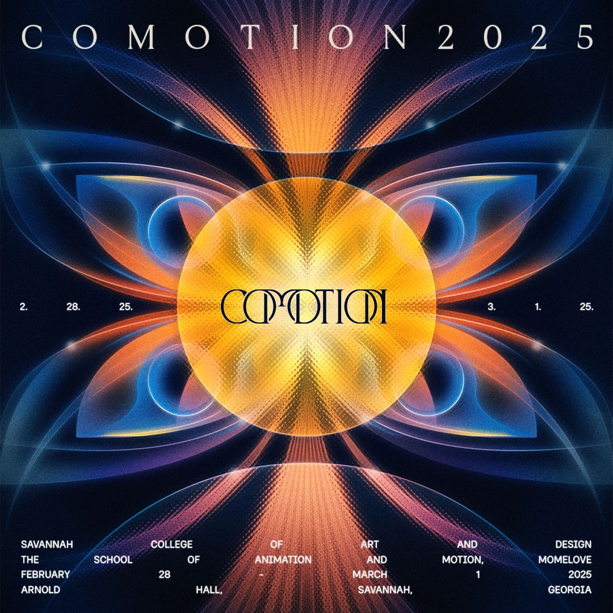

# CLAMP — Multidisciplinary Visual & Motion Design Studio

> A tactile, kinetic portfolio and design lab crafting physical-meets-digital experiences, 3D worlds, tactile web systems, and brand identities.



---

## 🌟 Key Features

* **🧲 Interactive Verlet/Spring Keychain Assembly:**
  * Real-time physical pendulum simulation with natural sway, momentum, drag-and-drop, and buoyant levitation.
  * 6 interactive acrylic charms (Motion, Branding, Editorial, Photoworks, Illustration, 3D Tech).
  * Smooth touch screen pointer capture (`touch-action: none`) for seamless dragging on phones and tablets.
* **🔊 Synthesized Web Audio Engine:**
  * Procedurally synthesized metallic carabiner clinks, hollow acrylic strikes, and typewriter ticks via Web Audio API oscillators (no external MP3/WAV dependencies for interaction SFX).
  * Global audio toggle control.
* **📋 Technical Spec Dossier (Yellow Board):**
  * Dynamic *"Clamp does [discipline]"* typewriter effect.
  * Active resting charm spec plate that reflects the active discipline in real time.
  * Live studio telemetry and UTC clock.
* **📁 Folder-Tab Featured Works Architecture:**
  * Industrial cut-out folder tabs with horizontal touch scrolling on mobile.
  * Multi-view mode switcher: Still Render, Turntable Video, and Wire/Assets passes.
  * Asset Matrix breakdown with interactive thumbnail swapping.
* **🔍 Slide-Out Spec Inspector Drawer:**
  * In-depth engineering breakdown: 3D subdivision counts, procedural shader maps, lighting rigs, ACEScg color workflows, color swatches, and deliverables.
* **🗃️ 24-Item Archival Grid & Modal Lightbox:**
  * Category filtering (All, 3D & Motion, Branding, Editorial, Illustration).
  * High-res modal preview with keyboard arrow navigation (<kbd>←</kbd> / <kbd>→</kbd>) and mobile-optimized viewport height.
* **📱 100% Responsive Design (Phone, Tablet & PC):**
  * Handcrafted breakpoints tailored for extra-large screens ($1440\text{px}+$)$), laptops ($1025\text{px} - 1399\text{px}$), tablets ($768\text{px} - 1024\text{px}$), smartphones ($\le 580\text{px}$), and ultra-compact devices ($360\text{px}$).
  * Animated industrial hamburger button with a slide-down mobile navigation drawer.

---

## 🛠️ Tech Stack

* **Frontend:** Vanilla JavaScript (ES6+), Semantic HTML5, Modular CSS3 Custom Properties
* **Audio:** Web Audio API (Synthesizer Oscillators & Gain Nodes)
* **Visuals:** 2D Canvas noise generator, CSS 3D Transforms, `preserve-3d`, dynamic drop shadows
* **Typography:** Space Grotesk, Fragment Mono, Inter, Caveat (Google Fonts)

---

## 🚀 Getting Started

Clone the repository and serve the files locally using any static web server:

```bash
# Clone repository
git clone https://github.com/Yuvansh-thx/clamp-studio.git
cd clamp-studio

# Start local server (Python 3)
python3 -m http.server 3000

# Or with Node.js
npx serve .
```

Open [http://localhost:3000](http://localhost:3000) in your web browser.

---

## 📄 License

Crafted for creative portfolio and educational presentation. All creative works & assets © 2026 CLAMP Studio.
