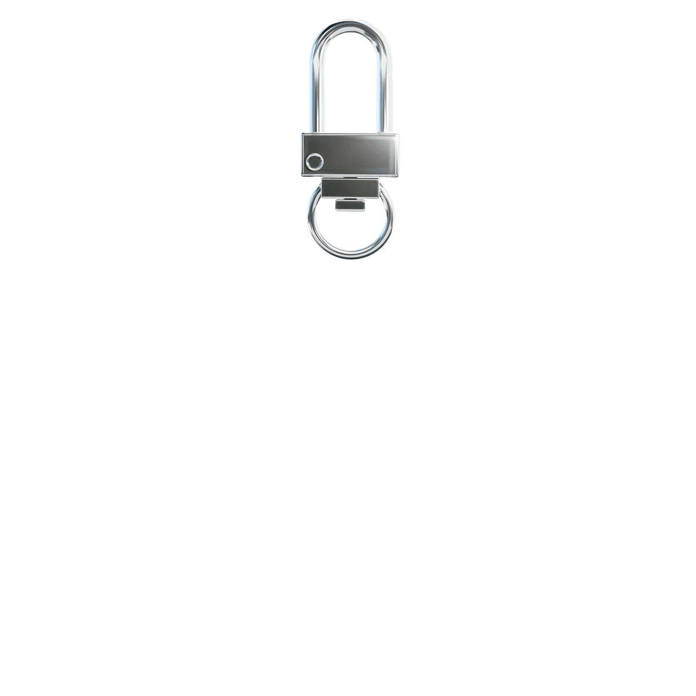
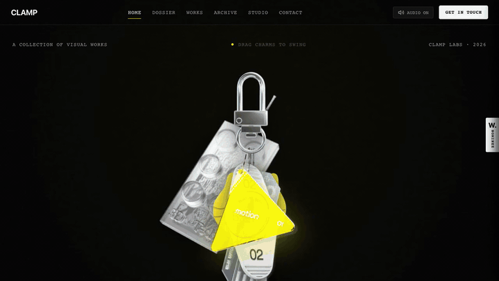
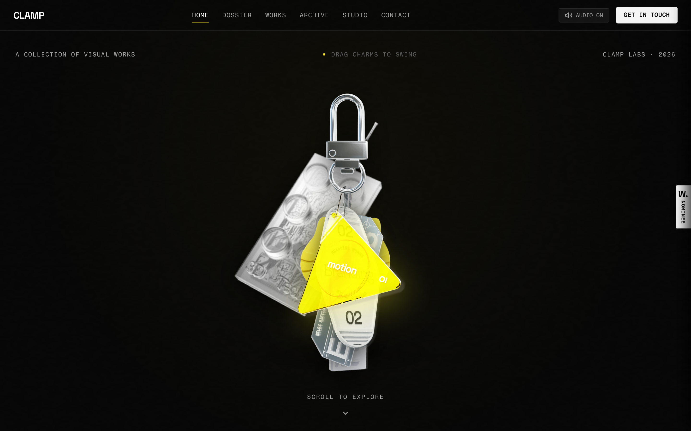
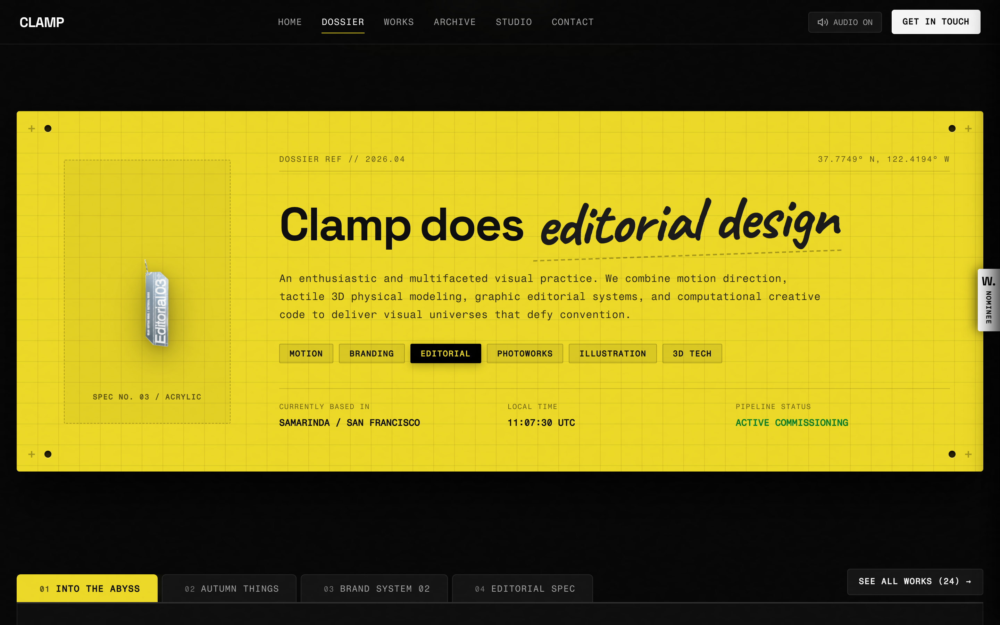
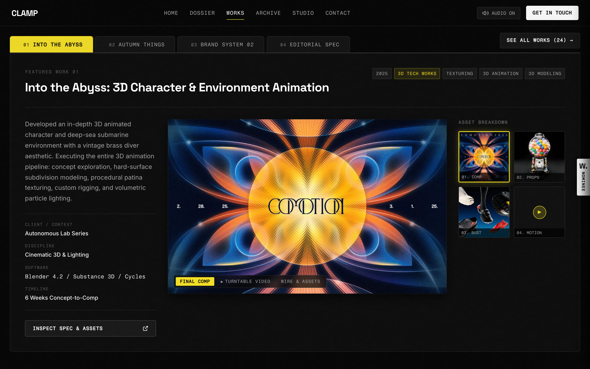
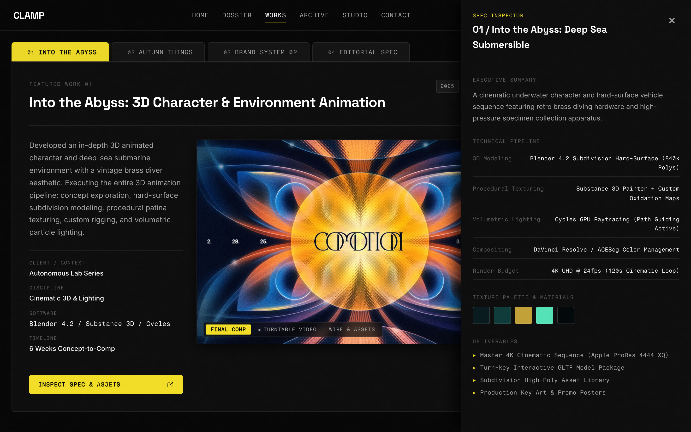
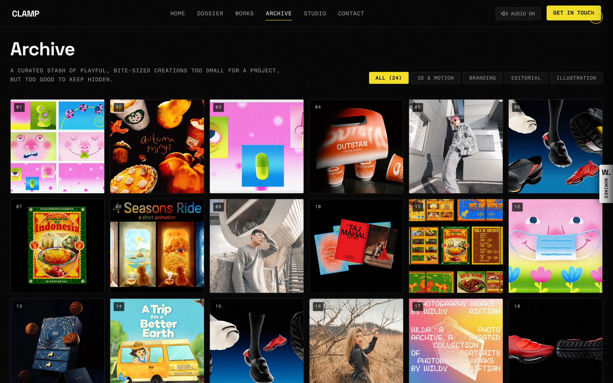
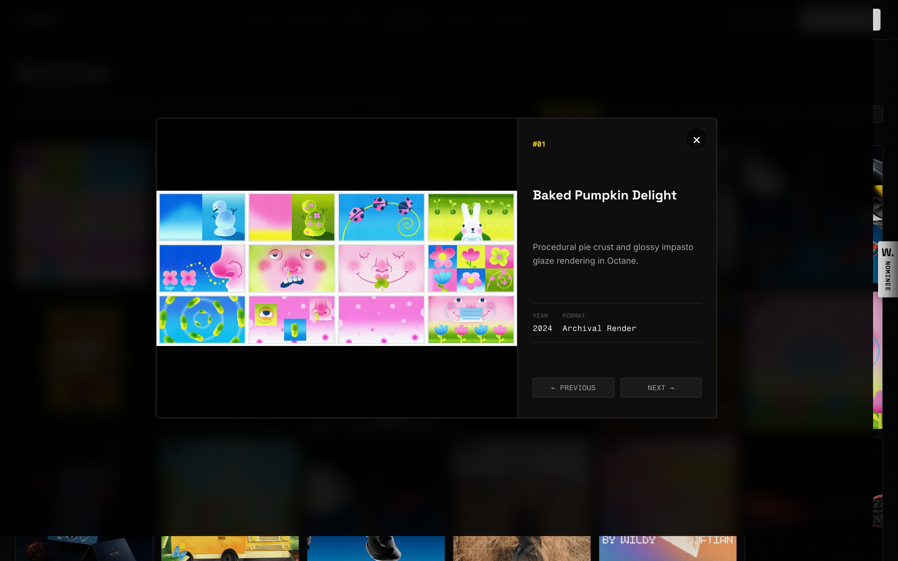
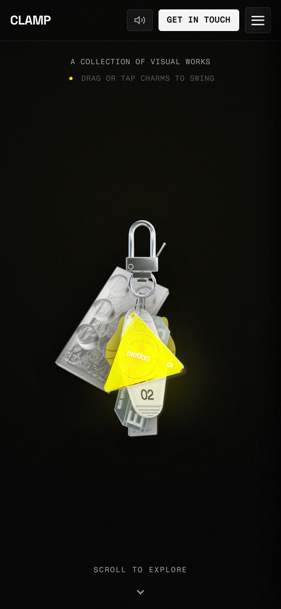

# CLAMP — Multidisciplinary Visual & Motion Design Studio

<p align="center">
  
</p>

<p align="center">
  <strong>A tactile, kinetic portfolio and design lab crafting physical-meets-digital experiences, 3D worlds, tactile web systems, and brand identities.</strong>
</p>

<p align="center">
  
  
  
  
  
  
  
</p>

---

## 🎬 Video Walkthrough & Interactive Demo

Experience CLAMP in motion — including the physical pendulum keychain, tactile sound synthesis, industrial folder-tab switching, slide-out engineering spec inspector, and 24-piece archival lightbox.

<p align="center">
  
</p>

> 🎥 **Video Formats:**
> - [High-Definition MP4 Video (H.264 / 60fps)](docs/videos/clamp-studio-demo.mp4)
> - [WebM Format Video](docs/videos/clamp-studio-demo.webm)

---

## 📸 Interface Gallery & Visual Tour

### 1. Hero Section & Kinetic Verlet Keychain
Interactive physical pendulum simulation with natural sway, momentum, pointer capture, and 6 acrylic discipline charms suspended from an industrial metallic carabiner.



---

### 2. Technical Spec Dossier & Discipline Board
Dynamic *"Clamp does [discipline]"* typewriter effect, resting charm spec plate reflecting live studio disciplines, and real-time studio telemetry with live UTC clock.



---

### 3. Folder-Tab Featured Works Architecture
Industrial cutout folder tabs with instant switching between Still Render, Turntable Video, and Wire/Assets passes, complete with interactive thumbnail swap matrix.



---

### 4. Slide-Out Spec Inspector Drawer
Comprehensive engineering breakdown revealing 3D polygon subdivision counts, procedural shader maps, lighting rigs, ACEScg color workflows, color swatches, and client deliverables.



---

### 5. 24-Item Archival Grid & Category Filtering
Industrial grid featuring 24 curated studio projects with instant category filtering across 3D & Motion, Branding, Editorial, and Illustration.



---

### 6. High-Res Modal Lightbox Preview
Full-screen high-fidelity preview with keyboard arrow navigation (<kbd>←</kbd> / <kbd>→</kbd>), tactile backdrop dismiss, and metadata dossier.



---

### 7. Responsive Mobile & Tablet Architecture
Handcrafted responsive breakpoints ensuring fluid touch interaction, gesture drag support, and mobile slide-down navigation across phones and tablets.

<p align="center">
  
</p>

---

## 🌟 Key Features

* **🧲 Interactive Verlet/Spring Keychain Assembly:**
  * Real-time physical pendulum simulation with natural sway, momentum, drag-and-drop, and buoyant levitation.
  * 6 interactive acrylic charms (Motion, Branding, Editorial, Photoworks, Illustration, 3D Tech).
  * Smooth touch screen pointer capture (`touch-action: none`) for seamless dragging on phones and tablets.
* **🔊 Synthesized Web Audio Engine:**
  * Procedurally synthesized metallic carabiner clinks, hollow acrylic strikes, and typewriter ticks via Web Audio API oscillators (zero external audio file dependencies).
  * Global audio toggle control with persisted state.
* **📋 Technical Spec Dossier (Yellow Board):**
  * Dynamic *"Clamp does [discipline]"* typewriter effect.
  * Active resting charm spec plate that reflects the active discipline in real time.
  * Live studio telemetry and UTC clock.
* **📁 Folder-Tab Featured Works Architecture:**
  * Industrial cut-out folder tabs with horizontal touch scrolling on mobile.
  * Multi-view mode switcher: Still Render, Turntable Video, and Wire/Assets passes.
  * Asset Matrix breakdown with interactive thumbnail swapping.
* **🔍 Slide-Out Spec Inspector Drawer:**
  * In-depth engineering breakdown: 3D subdivision counts, procedural shader maps, lighting rigs, ACEScg color workflows, color swatches, and deliverables.
* **🗃️ 24-Item Archival Grid & Modal Lightbox:**
  * Category filtering (All, 3D & Motion, Branding, Editorial, Illustration).
  * High-res modal preview with keyboard arrow navigation (<kbd>←</kbd> / <kbd>→</kbd>) and mobile-optimized viewport height.
* **📱 100% Responsive Design (Phone, Tablet & PC):**
  * Handcrafted breakpoints tailored for extra-large screens ($1440\text{px}+$)$), laptops ($1025\text{px} - 1399\text{px}$), tablets ($768\text{px} - 1024\text{px}$), smartphones ($\le 580\text{px}$), and ultra-compact devices ($360\text{px}$).
  * Animated industrial hamburger button with a slide-down mobile navigation drawer.

---

## 🛠️ Tech Stack

| Category | Technology |
| :--- | :--- |
| **Frontend Core** | Vanilla JavaScript (ES6+ Modules), Semantic HTML5, CSS3 Custom Properties |
| **Build & Dev Tool** | [Vite 6](https://vitejs.dev/) with Hot Module Replacement (HMR) |
| **Physics Simulation** | Verlet integration with spring constraints & pointer capture API |
| **Sound Synthesis** | Web Audio API (OscillatorNodes, GainNodes, BiquadFilterNodes) |
| **Visual Effects** | HTML5 2D Canvas noise generator, CSS 3D transforms (`preserve-3d`), dynamic drop shadows |
| **Typography** | Space Grotesk, Fragment Mono, Inter, Caveat (Google Fonts) |
| **Media Automation** | Playwright + FFmpeg for automated visual regression testing & media generation |

---

## 🚀 Getting Started

### Prerequisites
- Node.js (v18.0 or newer)
- npm or pnpm or yarn

### Installation & Run

```bash
# 1. Clone the repository
git clone https://github.com/Yuvansh-thx/clamp-studio.git
cd clamp-studio

# 2. Install dependencies
npm install

# 3. Start development server with Vite (HMR enabled)
npm run dev
```

Open [http://localhost:5175](http://localhost:5175) in your web browser.  
To view on your mobile device on the same local network, open the Network URL displayed in your terminal (e.g. `http://<your-local-ip>:5175`).

### Production Build

```bash
# Build optimized static distribution
npm run build

# Preview production build locally
npm run preview
```

### Media Regeneration

To re-capture all high-resolution screenshots and re-encode the walkthrough videos/GIF:

```bash
npm run capture
```

---

## 📁 Project Structure

```text
clamp-studio/
├── assets/                  # Studio project assets, videos, charm textures & audio
│   ├── charm-*.png          # High-resolution acrylic charm textures
│   ├── clamp-carabiner.png  # Metallic carabiner artwork
│   ├── video-*.mp4          # Turntable 3D project preview reels
│   └── archive-*.webp       # 24-piece archival photography & motion renders
├── docs/                    # Documentation screenshots and walkthrough videos
│   ├── screenshots/         # High-resolution retina screenshots (Desktop & Mobile)
│   │   ├── 01-hero-keychain.png
│   │   ├── 02-spec-dossier.png
│   │   ├── 03-featured-works-tabs.png
│   │   ├── 04-spec-inspector-drawer.png
│   │   ├── 05-archival-grid.png
│   │   ├── 06-lightbox-preview.png
│   │   └── 07-responsive-mobile.png
│   └── videos/              # Walkthrough media (GIF, MP4, WebM)
│       ├── clamp-studio-demo.gif
│       ├── clamp-studio-demo.mp4
│       └── clamp-studio-demo.webm
├── scripts/
│   └── capture.js           # Automated headless browser capture & FFmpeg video pipeline
├── index.html               # Main application entry point & semantic structure
├── index.css                # Industrial styling, CSS variables & responsive rules
├── main.js                  # Verlet physics, Web Audio synthesizer & interactivity
├── package.json             # Project metadata, dependencies & scripts
├── vite.config.js           # Vite server configuration (if applicable)
└── README.md                # Project documentation, media & architecture guide
```

---

## 📄 License

Crafted for creative portfolio, visual motion experimentation, and educational presentation.  
All creative visual works & assets © 2026 CLAMP Studio.
